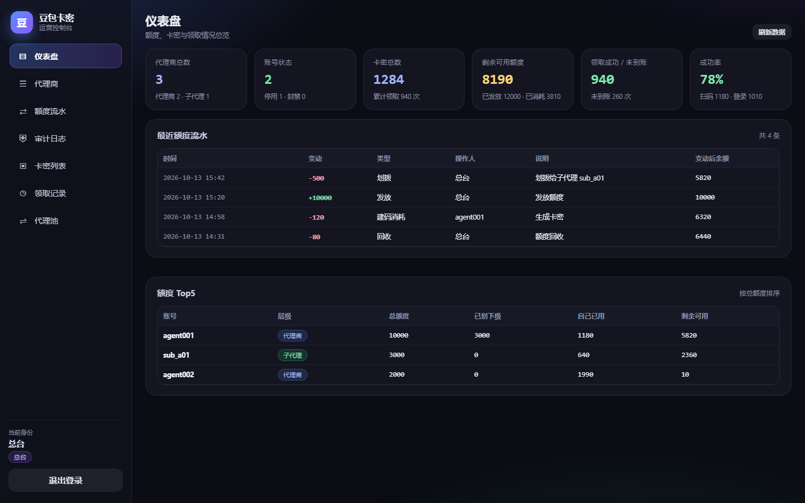
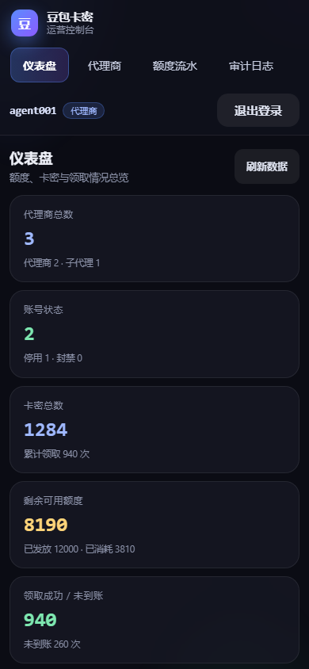
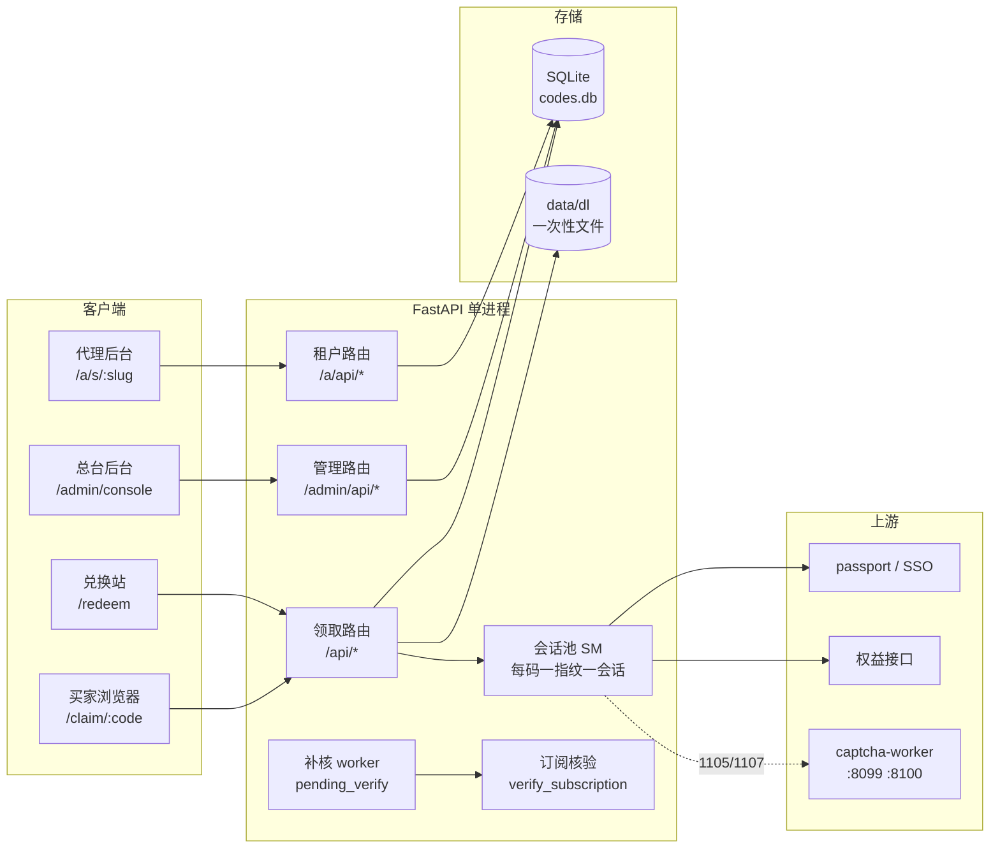
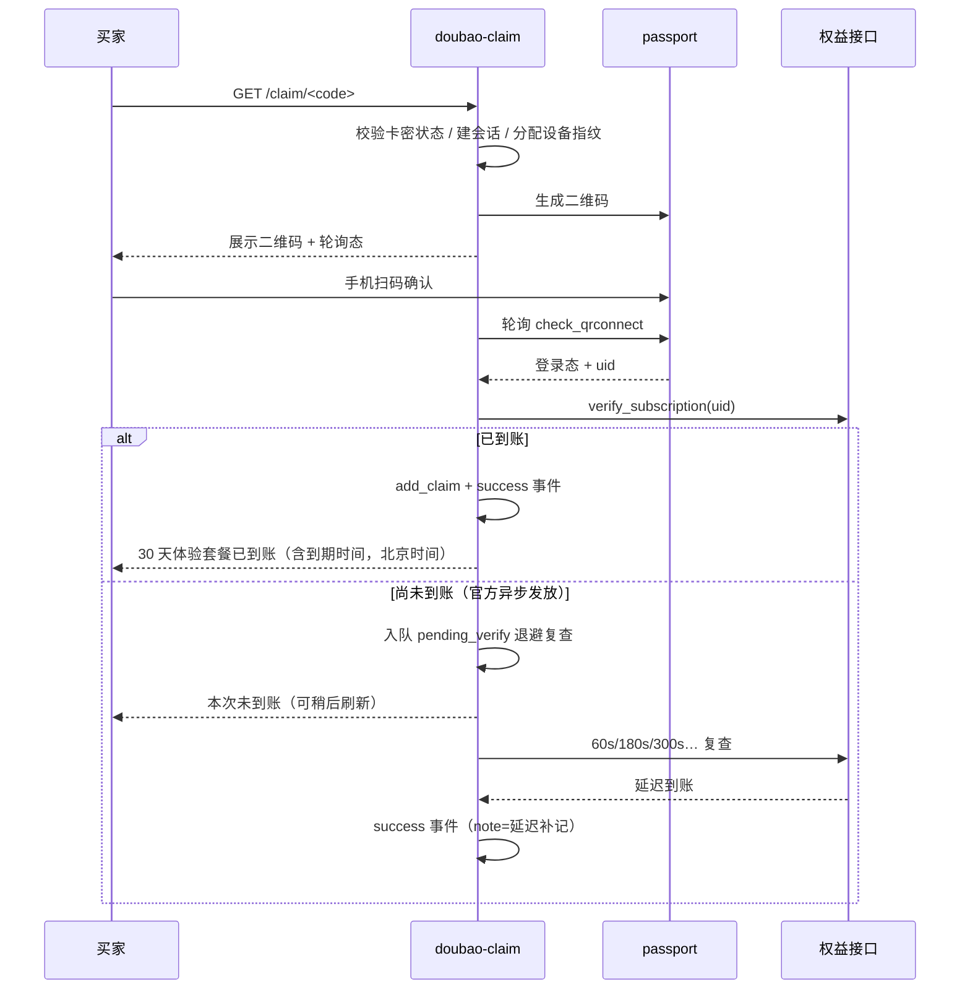

<div align="center">

# doubao-claim-hub

**卡密分发 · 扫码领取 · 多级代理运营 —— 一套自托管的会员权益发放中枢**

一码一会话 · 一码一设备指纹 · 官方到账自动核验 · 总台/代理/子代理三级权限

</div>

---

## 这是什么

`doubao-claim-hub` 是一个**自托管**的会员权益（体验套餐）发放与运营平台。它把「发卡 → 买家扫码/手机号登录 → 官方异步发放 → 到账核验 → 售后追溯」这条长链路全部收进一个进程里：

- **发卡方**在后台批量生成卡密（兑换码），可设批次 / 备注 / 归属代理 / 停用，导出纯净的卡密链接 TXT。
- **买家**打开链接 → 手机扫码确认登录 或 手机号 + 短信验证码登录 → 平台核验权益是否到账 → 页面给出「已到账 / 未到账」的确定结论。
- **运营方**在总台看全站流水、代理业绩、额度消耗、领取事件流（带时间 / IP / 账号 / uid），可以按代理下钻筛选、封禁 IP、批量建号、回收额度。
- **代理商 / 子代理**用专属网址（`/a/s/<slug>`）登录自己的后台，只能看到自己名下的人、码、额度和记录。

整个系统是**纯协议 + 单进程 + SQLite** 的轻量形态：一条 `uvicorn` 命令即可跑起来，无 Redis、无 MySQL、无消息队列；Docker / systemd 两种部署方式都给了模板。

> 本项目面向**自有账号、自有设备、已获授权**的运营场景。使用前请自行确认目标平台的服务条款与所在地法律法规，风险与合规责任由部署者承担（详见文末「使用边界」）。

---

## 核心能力

| 模块 | 能力 | 关键实现 |
|---|---|---|
| **卡密发行** | 批量生成、批次/备注、归属代理、停用/启用、一码一次领取、导出纯净链接 | 32 字符表剔除 `0 O 1 I L`，`secrets` 生成，SQLite 唯一索引 |
| **领取会话** | 每张卡密独占一套设备指纹 + 一条扫码会话，互不顶号 | `sessions.py` 会话池，`devices.py` 指纹源（random / pool） |
| **扫码领取** | 纯协议复刻 passport 签名、二维码生成/轮询、登录态核验 | `sdk.py`（`sign` / `qs` / `x-tt-passport-aid-sign` / XOR-0x05） |
| **手机号通道** | 短信发码 + 验证码登录，支持多国家号码 | `phone_login.py`，同实例 cookie + `biz_trace_id` 约束 |
| **人机验证** | 3D / 滑块自动通过，多 worker 池化 + 失败降级 | `captcha_worker.py`（真 Chromium worker，`/solve` 接口） |
| **到账补核** | 持久化复查「页面显示失败、官方其实已到账」，延迟补记 | `reconcile.py` 退避队列（60s→40min），幂等写 success |
| **多租户** | L0 总台 / L1 代理 / L2 子代理，额度划拨与回收 | `tenants.py` + `quota.py` + `authz.py`，全条件 UPDATE 防超发 |
| **专属入口** | 每个代理一个 `/a/s/<slug>`，子代理再分层 | `sites.py`，越权登录直接 403 |
| **充值码** | 总台生成额度充值卡，代理自助充值 | `recharge.py`，`DB` + 16 位 / 80 bit 熵 / 原子兑换 |
| **兑换站** | 兑换码 → 一组卡密链接，一键下载 TXT | `redeem.py`，HMAC-SHA256 索引 + 限速 + 失败锁定 |
| **一次性下载** | 后台生成 `/d/<token>`，默认下载一次即焚 | `dl.py`，32 字节 urlsafe token + 路径前缀校验 |
| **安全** | TOTP 两步验证、PBKDF2、HMAC Cookie、IP 白名单/封禁、审计 | `otp.py` / `guard.py` / `audit.py` |
| **运维** | 健康检查、事件流、日志滚动、安全重启 | `logs.py`、`/healthz`、`_safe_restart` 语义 |

---

## 界面预览

| 总台控制台（桌面端） | 手机端自适应（APP 风格） |
|---|---|
|  |  |

---

## 系统架构



**一条领取链路的时序：**



---

## 目录结构

```text
doubao-claim-hub/
├─ app/
│  ├─ main.py            # FastAPI 入口：领取路由 / 管理路由 / 静态挂载
│  ├─ sessions.py        # 每码独立会话 + 设备指纹 + 领取状态机（核心）
│  ├─ sdk.py             # passport 纯协议 SDK（签名 / 二维码 / 权益核验）
│  ├─ phone_login.py     # 手机号 + 短信验证码纯协议登录
│  ├─ captcha_worker.py  # 3D/滑块人机验证 worker 客户端（池化）
│  ├─ fingerprint.py     # UA / 设备指纹自洽档案生成
│  ├─ devices.py         # 设备码来源（random / pool）与管理接口
│  ├─ proxy.py           # 出口代理池（会话级粘性，失败回落直连）
│  ├─ reconcile.py       # 长尾补核 worker（延迟到账补记，幂等）
│  ├─ store.py           # SQLite 存储层（codes / events / settings）
│  ├─ tenants.py         # 多租户数据层（L0/L1/L2）
│  ├─ quota.py           # 额度事务层（防并发超发）
│  ├─ authz.py           # 租户认证与权限
│  ├─ tenant_api.py      # 代理端 / 总台端 API（/a/api, /admin/api）
│  ├─ sites.py           # 代理专属入口（/a/s/<slug>）
│  ├─ recharge.py        # 充值码（额度充值卡）
│  ├─ redeem.py          # 兑换站（兑换码 → 一组卡密链接）
│  ├─ dl.py              # 一次性下载链接
│  ├─ guard.py           # IP 白名单 + 自动/手动封禁
│  ├─ audit.py           # 操作审计日志
│  ├─ otp.py             # TOTP / PBKDF2 / 恢复码
│  ├─ logs.py            # 日志滚动与裁剪
│  └─ static/            # 前端（无构建步骤，原生 HTML/CSS/JS）
│     ├─ index.html  app.js  style.css            # 买家领取页
│     ├─ admin.html  admin.js  admin.css          # 总台后台
│     ├─ console.html console.js console.css      # 运营控制台（L0/L1/L2 共用）
│     ├─ redeem.html  redeem.js                   # 兑换站
│     ├─ admin_redeem.html / .js                  # 兑换站后台面板
│     └─ tenant_login.html  landing.html          # 代理登录 / 落地页
├─ deploy/
│  ├─ install.sh              # 一键部署（venv + systemd）
│  └─ doubao-claim.service    # systemd 模板
├─ tests/                     # 领取状态机 / 幂等 / 终态单测
├─ docs/                      # 界面截图
├─ data/                      # 运行期数据（首次启动自动建库；勿入库）
├─ Dockerfile
├─ docker-compose.yml
├─ requirements.txt
└─ README.md
```

---

## 快速开始

### 方式一：Docker Compose（推荐）

```bash
git clone https://github.com/<your-name>/doubao-claim-hub.git
cd doubao-claim-hub

# 先把 compose 里的 ADMIN_PASSWORD 改成你自己的强密码
docker compose up -d --build

# 打开
# 买家领取页 : http://<host>:8080/
# 总台后台   : http://<host>:8080/admin
# 运营控制台 : http://<host>:8080/admin/console
```

数据落在 `./data/codes.db`（挂载卷），容器重启不丢卡密。

### 方式二：裸机（venv + systemd）

```bash
sudo bash deploy/install.sh
# 脚本会：装 python3-venv → 复制代码到 /root/doubao-claim →
#        建 venv 装依赖 → 写 systemd unit → 启动并打印后台密码
```

手动等价步骤：

```bash
python3 -m venv .venv
.venv/bin/pip install -r requirements.txt

export ADMIN_PASSWORD='改成你的强密码'
export DATA_DIR="$PWD/data"
export TZ=Asia/Shanghai

.venv/bin/uvicorn app.main:app --host 0.0.0.0 --port 8080 --workers 1
```

> **必须单 worker。** 会话池、限速窗口、补核队列都在进程内存里，多 worker 会各算各的（重复领取 / 限速失效 / 二维码互顶）。

### 首次进入后台

1. 打开 `/admin`，用 `ADMIN_PASSWORD` 登录。
2. 建议立刻在「系统设置」里改密码，并绑定 **TOTP 两步验证**（扫码或手填密钥）。
3. 如服务器有固定出口 IP，把后台 IP 加白（`/admin` → 安全 → 一键加白），避免被自动封禁误伤。
4. 生成第一批卡密 → 复制链接 → 发给买家。

### 人机验证 worker（可选）

只有在手机号通道被官方 3D/滑块拦截时才需要：

```bash
# 每台 worker 一个端口，最多建议 2~4 个
python -m app.captcha_worker --port 8099
export CAPTCHA_WORKER_URLS="http://127.0.0.1:8099,http://127.0.0.1:8100"
```

worker 起不来 / 超时的时候，主流程会**降级返回可读失败原因**，不会 500。

---

## 配置项

所有配置都走环境变量，改完重启生效。下面按用途分组。

### 1）基础与部署

| 变量 | 默认 | 说明 |
|---|---|---|
| `PORT` | `8080` | 监听端口 |
| `DATA_DIR` | `./data` | 运行期数据目录（SQLite / 下载文件 / 密钥） |
| `DB_PATH` | `$DATA_DIR/codes.db` | SQLite 路径 |
| `LOG_DIR` | `./logs` | 日志目录 |
| `APP_LOG_FILE` | `$LOG_DIR/app.log` | 应用日志文件 |
| `TZ` | 系统 | 建议 `Asia/Shanghai`；后台时间统一按北京时间展示 |
| `BASE_URL` | 自动推断 | 反代 / 域名场景必填，如 `https://claim.example.com` |
| `ALLOWED_HOSTS` | 空（不限） | 逗号分隔的 Host 白名单 |
| `TRUST_PROXY` | `0` | `1` = 信任 `X-Forwarded-For`（放在反代后面才开） |
| `MAX_BODY_BYTES` | `2097152` | 请求体上限（2 MB） |
| `SITE_SECRET` | 自动生成 | Cookie / 签名密钥；不设则首次启动写入 `data/.secret` |
| `HEALTHZ_DETAIL` | `0` | `1` = `/healthz` 返回完整明细 |

### 2）领取主流程

| 变量 | 默认 | 说明 |
|---|---|---|
| `MODE` | `random` | 设备码来源：`random` 本地随机 / `pool` 读 `data/devices.json` |
| `REQUIRE_CODE` | `1` | `1` = 必须带有效卡密才能进领取页 |
| `CLAIMS_PER_CODE` | `0` | 每码可成功领取次数；`0` = 不限（后台「一码一次」开关优先） |
| `VERIFY_RETRY` | `3` | 到账核验轮数 |
| `VERIFY_SLEEP` | `7` | 每轮间隔（秒） |
| `VERIFY_TIMEOUT` | `8` | 单次核验超时（秒） |
| `AUTO_NEXT` | `0` | `1` = 领取成功后自动换新二维码（**默认关**，避免误刷新打断已成功状态） |
| `MAX_SESSIONS` | `150` | 同时在线领取会话上限 |
| `THREAD_POOL_SIZE` | `96` | 后台线程池大小 |
| `SESSION_IDLE_TTL` | `5400` | 空闲会话回收（秒） |
| `SESSION_DONE_TTL` | `21600` | 已完成会话保留（秒） |

### 3）二维码会话调度

| 变量 | 默认 | 说明 |
|---|---|---|
| `QR_CHECK_TIMEOUT` | `8` | 轮询 `check_qrconnect` 超时（秒） |
| `QR_REQ_TIMEOUT` | `10` | 建码 / 其他请求超时 |
| `QR_POLL_SEC` | `3.0` | 常规轮询间隔 |
| `QR_POLL_FAST_SEC` | `1.2` | 已被扫码后的快轮询间隔 |
| `QR_POLL_IDLE_SEC` | `15` | 长时间无变化后的慢轮询 |
| `QR_POLL_JITTER` | `0.15` | 轮询抖动比例（抗规律性识别） |
| `QR_POLL_DEAD_SEC` | `120` | 轮询连续失败多久判定会话失活 |
| `QR_GEN_GATE` | `5` | 同时建码并发闸门 |
| `QR_UNSCANNED_MAX` | `40` | 未扫码会话上限 |
| `QR_REFRESH_BELOW` | `10` | 二维码剩余有效期低于该秒数时预刷新 |
| `QR_SCAN_CONFIRM_GRACE` | `180` | 已扫码后的确认宽限（秒） |
| `QR_SCAN_HOLD_GRACE` | `30` | 扫码态保持宽限 |
| `QR_ORPHAN_AGE` / `QR_ORPHAN_MIN_ROT` | `1200` / `3` | 孤儿会话回收阈值 |
| `QR_ROTATE_UNWATCHED` / `QR_UNWATCHED_AFTER` | `0` / `30` | 未被观看时是否轮换 |
| `QR_FAST_ANON` / `QR_POLL_DIRECT` | `0` / `1` | 快路径开关（排障用） |

### 4）手机号通道与人机验证

| 变量 | 默认 | 说明 |
|---|---|---|
| `PHONE_STATE_TTL` | `420` | 手机号登录状态保留（秒） |
| `CAPTCHA_WORKER_URLS` | `http://127.0.0.1:8099,http://127.0.0.1:8100` | worker 地址，逗号分隔 |
| `CAPTCHA_WORKER_OFF` | 空 | `1` = 完全关闭人机验证通道 |
| `CAPTCHA_WORKER_WAIT` | `300` | 排队等待上限（秒） |
| `CAPTCHA_WORKER_TIMEOUT` | `420` | 单次求解超时（秒） |
| `CAPTCHA_LOGIN_WEB` | `1` | 是否允许 web 端求解 |
| `CAPTCHA_SLIDE_MAX_WORKERS` | `2` | 滑块并发 worker 数 |
| `CAPTCHA_SLIDE_TRIES` / `CAPTCHA_SLIDE_RETRY` | `2` / `1` | 尝试次数 / 失败重试 |
| `CAPTCHA_SLIDE_BUDGET` | `150` | 单次求解预算（步数） |

### 5）到账补核

| 变量 | 默认 | 说明 |
|---|---|---|
| `RECONCILE` | `0` | `1` = 开启持久化补核 worker |
| `RECONCILE_INTERVAL` | `300` | 扫描间隔（秒） |
| `RECONCILE_SCAN_LIMIT` | `20` | 单轮扫描条数 |
| `RECONCILE_MAX_AGE` | 内置 | 超过该年龄不再补核（秒） |
| `LATE_RECHECK_DELAYS` | `60,180,300,600,1200,2400` | 会话内复查退避序列（秒） |
| `RECHECK_MIN_GAP` | `20` | 两次复查最小间隔 |

### 6）多租户与代理端

| 变量 | 默认 | 说明 |
|---|---|---|
| `TENANT_MAX_GEN` | `2000` | 代理单次生成卡密上限 |
| `TENANT_GEN_RATE` | `30` | 生成限速（次/窗口） |
| `TENANT_BATCH_MAX` | `100` | 批量建代理单次上限 |
| `TENANT_DELETE_MAX` | `200` | 批量删除单次上限 |
| `TENANT_PWD_MIN` / `TENANT_PWD_MAX` | `8` / `64` | 代理密码长度 |
| `TENANT_PWD_RATE` / `TENANT_PWD_RATE_SEC` | `5` / `600` | 改密限速 |
| `TENANT_RECYCLE_RATE` / `TENANT_RECYCLE_WIN` | `30` / `600` | 回收额度限速 |
| `TN_SESSION_HOURS` | `12` | 代理端登录有效期 |
| `TN_LOGIN_MAX_FAIL` / `TN_LOGIN_BAN_SEC` | `8` / `86400` | 登录失败锁定 |
| `TN_LOGIN_RATE` | `30` | 登录限速 |
| `SITE_SLUG_LEN` | `7` | 专属入口 slug 长度 |

### 7）额度 / 充值码 / 兑换站 / 下载

| 变量 | 默认 | 说明 |
|---|---|---|
| `CODE_LEN` | `8` | 卡密长度（字符集 32，去易混字符） |
| `CODE_RATE` | `90` | 卡密查询限速 |
| `RC_BODY_LEN` | `16` | 充值码随机段长度 |
| `RC_MAX_COUNT` / `RC_MAX_AMOUNT` | `2000` / `100000` | 单批数量 / 单张面额上限 |
| `RC_GEN_RATE` | `20` | 充值码生成限速 |
| `RC_ACCT_RATE` / `RC_ACCT_WIN` | `10` / `600` | 单账号兑换限速 |
| `RC_TRY_RATE` / `RC_TRY_WIN` | `15` / `600` | 兑换失败尝试限速 |
| `REDEEM_MAX_CODES` / `REDEEM_MAX_PER_GROUP` / `REDEEM_MAX_TOTAL` | `500` / `500` / `5000` | 兑换站批量上限 |
| `REDEEM_RL_IP_LIMIT` / `REDEEM_RL_IP_WINDOW` / `REDEEM_RL_ALL_LIMIT` | `15` / `600` / `240` | 兑换站限速 |
| `DL_TTL_HOURS` / `DL_TTL_MAX_HOURS` | `24` / `720` | 下载链接有效期 |
| `DL_MAX_HITS` / `DL_MAX_HITS_CAP` | `100000` | 下载次数上限 |
| `DL_TOTAL_CAP_MB` | `256` | 下载文件总量上限 |
| `DL_TOKEN_BYTES` | `32` | token 熵（字节） |
| `DL_RATE` / `DL_GEN_RATE` | `90` / `20` | 下载 / 生成限速 |
| `DL_PAGE` | `50` | 下载列表分页 |

### 8）后台安全

| 变量 | 默认 | 说明 |
|---|---|---|
| `ADMIN_PASSWORD` | `CHANGE_ME_PLEASE` | **上线必须改**；改过后以库里的 PBKDF2 哈希为准 |
| `ADMIN_SESSION_HOURS` | `12` | 后台登录有效期 |
| `ADMIN_IP_WHITELIST` | 空 | 后台 IP 白名单（逗号分隔 / CIDR） |
| `LOGIN_MAX_FAIL` / `LOGIN_LOCK_SEC` / `LOGIN_BAN_SEC` | `8` / `600` / `86400` | 后台登录失败策略 |
| `SHOW_ADMIN_REAL` | `0` | `1` = 后台展示真实出口信息（排障用） |
| `DEMO` | `0` | `1` = 演示模式（不写真实数据） |
| `AUDIT_KEEP` | `300` | 审计日志保留条数 |

### 9）出口 / 指纹调优（进阶）

| 变量 | 默认 | 说明 |
|---|---|---|
| `EXIT_GUARD` / `EXIT_GUARD_TRIES` | `1` / `3` | 出口质量校验开关与重试 |
| `EXIT_FOLLOW_SCAN_OFF` | `0` | `1` = 扫码后不再跟随切换出口 |
| `CN_EXIT_REGION` / `R84Q_DEFAULT_REGION` | `US` / `HK` | 默认出口地区 |
| `EXIT_CANARY_CN_US` | `0` | 中美出口对照探针（排障） |
| `GIFT_NEW_TOLERANCE` | `90` | 「新发放」判定容差（秒） |
| `GIFT_FRESH_DAYS` / `GIFT_RECENT_DAYS` | `29.5` / `25` | 到期时间判定的新鲜度阈值（天） |

> 完整变量共 100+ 项，全部可在 `app/*.py` 里 `os.environ.get(...)` 检索到；上面是会影响行为的主要项。改完记得重启进程。

---

## 使用流程

### 总台（L0）

1. **登录** `/admin` → 绑定 TOTP → 改密。
2. **建代理**：「代理管理」单个新建，或「批量新建」输入数量 + 参数一次生成，结果可一键复制（每行 `账号  密码`）。
3. **分配额度**：给代理划拨张数，全部走流水（`quota_ledger`），可随时回收。
4. **发卡**：「卡密管理」按批次生成，填备注、选归属代理；每张卡密固定**只能被领取一次**（该限制不可在设置里放开）。
5. **看数据**：「领取记录」按卡密 / 类型 / 代理筛选，页脚显示「第 X / Y 页 · 共 N 条」；顶部 chips 是**当前筛选范围**的进入 / 扫码 / 登录成功 / 领取成功 / 未到账计数。
6. **风控**：IP 白名单、手动/自动封禁、审计日志、登录失败锁定。

### 代理商（L1）/ 子代理（L2）

- 用专属网址 `/a/s/<slug>` 登录（子代理是 `/a/s/<slug>/<sub>`），拿别人分支的网址登录会 403。
- 只能看到自己名下（总代含下级）的卡密、记录、额度、流水。
- 可以自助用充值码充额度、给下级划拨、生成卡密、导出链接 TXT（**只导链接，不导卡密本体**）。

### 买家

```text
1. 打开  https://<host>/<CODE>          （或 /claim?code=<CODE>）
2. 扫码：微信/相机扫二维码 → 手机上确认登录
   或   点「手机号登录」→ 填号码 → 收验证码 → 提交
3. 页面显示核验中 → 已到账（含到期时间，北京时间）
                 → 未到账（系统自动排队补核，稍后刷新即可）
```

**关于「已到账后不要关页面」**：领取成功后会话进入终态，页面不会再自动弹新码；若你手动点「重新获取」，属于新的一次领取请求，旧的成功态仍然保留（`success` 是终态，不可被后续失败覆盖）。

---

## API 概览

> 全部接口返回 JSON；管理接口走 Cookie 鉴权（`adm` / `tn`），HMAC 签名 + 有效期校验。下表只列路径与用途，不做逐字段展开。

### 买家 / 领取

| 方法 | 路径 | 说明 |
|---|---|---|
| `GET` | `/` `/claim` | 领取页（需有效卡密，取决于 `REQUIRE_CODE`） |
| `GET` | `/api/state` | 当前会话快照（状态 / 二维码 / 账号 / 到期时间） |
| `POST` | `/api/next` | 换一张二维码（重开一次领取尝试） |
| `POST` | `/api/recheck` | 手动触发到账复查 |
| `POST` | `/api/phone/send` | 发送短信验证码 |
| `POST` | `/api/phone/login` | 短信验证码登录 |
| `POST` | `/api/phone/reset` | 重置手机号登录态 |
| `GET` | `/api/countries` | 支持的国家/区号列表 |
| `GET` | `/api/stats/segments` | 分段统计（管理端图表用） |
| `POST` | `/api/region` | 切换出口地区 |

### 兑换站

| 方法 | 路径 | 说明 |
|---|---|---|
| `GET` | `/redeem` | 兑换页（输入 20 位兑换码） |
| `POST` | `/api/redeem/claim` | 兑换：返回该组卡密链接 |
| `POST` | `/api/redeem/reset` | 清除本机兑换记录 |
| `GET` | `/d/{token}` | 一次性下载链接（默认下载即焚） |

### 总台 `/admin/api`

| 分组 | 端点 |
|---|---|
| 认证 | `POST /login` `GET /logout` `GET /authinfo` `POST /password` |
| 两步验证 | `POST /totp/setup` `/totp/enable` `/totp/disable` `/totp/recovery` |
| 概览 | `GET /dashboard` `GET /security` `GET /stats/segments` |
| 卡密 | `POST /gen` `GET /list`（支持 `owner_id`）`POST /set` `POST /codes/disable` `GET /export` |
| 记录 | `GET /logs`（支持 `code` / `kind` / `owner_id`） |
| 租户 | `GET/POST /tenants` `POST /tenants/batch` `POST /tenants/batch_delete` `POST /tenants/{tid}/quota|status|password|newpwd` `GET /tenants/{tid}/secret` |
| 额度 / 审计 | `GET /quota/ledger` `GET /audit` |
| 充值码 | `POST /recharge/gen` `GET /recharge` `POST /recharge/void` |
| 兑换站 | `GET /redeem` `GET /redeem/meta` `POST /redeem/create` `GET /redeem/list` `GET /redeem/batch/{id}` `GET /redeem/export/{id}` `POST /redeem/disable` |
| 下载 | `GET/POST /dl` `POST /dl/revoke` |
| 设备 | `GET /devices` `POST /devices/import` `GET /devices/export` `POST /devices/clear` |
| 风控 | `GET/POST /guard` `POST /guard/whitelist` `POST /guard/ban` `POST /guard/unban` |
| 出口 | `GET/POST /proxy` `POST /proxy/test` |
| 入口 | `GET /sites` `POST /sites/reset` |
| 设置 | `POST /setting` |

### 代理端 `/a/api`

| 分组 | 端点 |
|---|---|
| 认证 | `POST /a/login` `GET /a/logout` `GET /a/api/me` `POST /a/api/me/password` |
| 概览 | `GET /a/api/dashboard` |
| 下级 | `GET/POST /a/api/tenants` `POST /tenants/{id}/quota|status|recycle` `POST /tenants/{tid}/newpwd|password` `GET /tenants/{tid}/secret` |
| 卡密 | `GET /a/api/codes` `POST /a/api/gen` `POST /a/api/codes/disable` |
| 记录 | `GET /a/api/logs` `GET /a/api/quota/ledger` `GET /a/api/audit` |
| 充值 | `POST /a/api/recharge` `GET /a/api/recharge/mine` |
| 下载 | `GET/POST /a/api/dl` `POST /a/api/dl/revoke` |
| 专属入口 | `GET /a/s/{slug}` `/a/s/{slug}/{sub}` `/a/s/{slug}/console` |
| 站点信息 | `GET /a/api/site_info` `POST /a/api/site_login` `GET /a/api/my_site` `POST /a/api/my_site/reset` |

### 运维

| 方法 | 路径 | 说明 |
|---|---|---|
| `GET` | `/healthz` | 健康检查：会话数 / 卡密统计 / 建码闸门 / 进程新鲜度 |
| `GET` | `/admin/console` | 运营控制台（L0/L1/L2 共用一套前端） |

---

## 数据模型

单库 `codes.db`（SQLite，WAL 模式），全部表：

| 表 | 作用 |
|---|---|
| `codes` | 卡密主表：状态、批次、备注、归属（`owner_id` / `root_id`）、访问与领取计数 |
| `events` | 领取事件流：`enter` / `scan` / `login` / `success` / `fail` / `phone_send` …，带 IP、UA、uid、结构化 detail |
| `settings` | 全局键值：后台密码哈希、开关、公告、白名单、密钥 |
| `pending_verify` | 补核队列：待复查的码 + 退避时间 + 结果 |
| `tenants` | 租户：L0 总台 / L1 代理 / L2 子代理，额度与状态 |
| `quota_ledger` | 额度流水：划拨 / 回收 / 生成 / 充值 |
| `audit_log` | 操作审计（保留最近 N 条） |
| `downloads` | 一次性下载链接：token、命中次数、有效期、撤销位 |
| `recharge_codes` | 充值码：面额、状态、兑换人 |
| `redeem_batches` / `redeem_groups` / `redeem_codes` / `redeem_links` / `redeem_attempts` | 兑换站：批次 → 组 → 兑换码（HMAC 索引）→ 卡密链接 → 尝试记录 |

**为什么用 SQLite**：单进程 + 本地盘 + 万级 QPS 以下的场景，SQLite 的读性能足够，省掉一整套运维；所有写操作都包在 `threading.RLock` + 事务里，配合 `UPDATE ... WHERE status='unused'` 这类条件更新保证原子性。

---

## 可靠性设计（踩过的坑都在这）

| 问题 | 现象 | 现在的做法 |
|---|---|---|
| **多用户互顶** | A 扫码时 B 一进页面，A 的码被顶掉 | 每张卡密独占一套设备指纹 + 一条会话（`sessions.py`） |
| **重复记成功** | 同一码出现两条 `success` | 幂等判定：**uid 优先**，无 uid 时按昵称归一化；不同 uid 不做昵称兜底 |
| **成功被覆盖** | 成功后又被手机号重复登录 / 迟到轮询改成 fail | `success` 设为终态，后续写操作一律短路（`tests/test_success_lock.py`） |
| **假失败** | 页面显示未到账，官方其实已发放 | `pending_verify` 持久化退避复查，到账后补记 `success`（note=延迟补记） |
| **重启丢状态** | 重启后已领过的码又出码 | 会话初始化时从库回填 `claims` / `success`，`claimed` 不再默认 False |
| **额度超发** | 并发下生成超过剩余额度 | 额度全部走条件 `UPDATE`，失败抛中文 `QuotaError` |
| **线程堆积** | 代理被限速时轮询线程越积越多 | 轮询单独短超时（`QR_CHECK_TIMEOUT`）+ 死会话回收 + 并发闸门 |
| **人机验证挂** | worker 挂了整站 500 | 捕获所有异常 → 返回可读失败原因，主流程继续可用 |
| **代理池挂** | 出口全不可用导致全站失败 | 测试失败自动回落直连，绝不冒泡成 500 |
| **日志撑爆磁盘** | `app.log` 无限增长 | `app/logs.py` 原子裁剪；`events` 长期保留不删 |
| **随机重启打断领取** | 滚动重启时正好有人在扫码 | `_safe_restart` 语义：`verifying==0 && scanned==0` 连续两次才重启，最多等 600s |

---

## 安全设计

- **后台鉴权**：Cookie `adm` = `<ts>.<HMAC-SHA256(secret, "admin:<cred>:<ts>")>`，服务端常量时间比较；租户 Cookie `tn` 同构。
- **密码**：PBKDF2 哈希入库，登录成功后自动把旧格式升级；`ADMIN_PASSWORD` 只在库里没有哈希时作为初始值。
- **两步验证**：TOTP（30s / 6 位 / ±1 时间片），纯标准库实现，另带一次性恢复码。
- **IP 控制**：白名单只护后台；封禁全站生效；白名单 IP 永不被自动封禁（防自锁）。
- **限速与熔断**：登录、生成、改密、回收、兑换、下载全部有独立窗口限速；兑换失败按码锁定 + 全局熔断。
- **防枚举**：兑换码用 HMAC-SHA256 索引比对，不依赖明文等值；错误信息统一，不区分「不存在 / 已用 / 已停用」。
- **注入防护**：全部参数化 SQL；下载文件路径做 `realpath` 前缀校验。
- **敏感信息**：日志里的代理密码一律掩码 `***`；余额 / 卡密 / 兑换码只在必要接口出现。
- **数据面**：`data/` 目录（含 `codes.db`、`.secret`、`dl/`）不要提交到版本库，也不要放在公网可读路径。

---

## 测试

`tests/` 下是**独立可执行**的回归脚本（不依赖 pytest，直接打 HTTP + 直连数据库），每个文件头部都写了跑法和对应线上事故：

```bash
cd doubao-claim-hub
.venv/bin/python tests/test_success_lock.py        # 成功后状态不可被覆盖
.venv/bin/python tests/test_success_terminal.py    # success 是终态（CLAIMS_PER_CODE=0）
.venv/bin/python tests/test_late_idempotent.py     # 库级幂等 + 重启恢复（隔离 DB，不碰生产）
.venv/bin/python tests/test_done_state_live.py     # done 码重启后不再 403（需本地服务在跑）
.venv/bin/python tests/test_disabled_success.py    # 成功后停用：成功页不能被抹掉
```

> `test_done_state_live.py` / `test_disabled_success.py` 会连本机 `127.0.0.1:8080`，并在库里建临时码（用完即删）。别对生产直接跑。
>
> 脚本头部写死了 `sys.path.insert(0, "/root/doubao-claim")`，装到别的目录时先改这一行。

---

## 部署

### 反向代理（Nginx 示例）

```nginx
server {
    listen 443 ssl http2;
    server_name claim.example.com;

    client_max_body_size 4m;

    location / {
        proxy_pass         http://127.0.0.1:8080;
        proxy_http_version 1.1;
        proxy_set_header   Host              $host;
        proxy_set_header   X-Real-IP         $remote_addr;
        proxy_set_header   X-Forwarded-For   $proxy_add_x_forwarded_for;
        proxy_set_header   X-Forwarded-Proto $scheme;
        proxy_read_timeout 120s;
    }
}
```

配了反代后记得：

```bash
export BASE_URL="https://claim.example.com"   # 生成卡密链接用它
export TRUST_PROXY=1                          # 才会读 X-Forwarded-For
```

### 备份

```bash
# SQLite 在线安全备份（不要直接 cp 正在写的库）
sqlite3 data/codes.db ".backup '/backup/codes-$(date +%F).db'"

# 每天一次，保留 14 天
find /backup -name 'codes-*.db' -mtime +14 -delete
```

### 升级

```bash
git pull
.venv/bin/pip install -r requirements.txt      # 依赖有变才需要
systemctl restart doubao-claim
curl -s localhost:8080/healthz
```

静态文件（`app/static/*`）按请求读盘，改前端不用重启；改 `app/*.py` 必须重启。

---

## 常见问题

**Q：为什么必须单 worker？**
会话池、限速窗口、补核队列都是进程内状态。`--workers 2` 会让同一张卡密在两个进程里各有一套会话，出现「两个人同时领」「限速翻倍」「二维码互顶」。要横向扩展得先把状态外置（Redis），当前版本不支持。

**Q：买家说「页面显示未到账，但我这边看到已经到账了」？**
官方的 30 天权益是**异步发放**的（实测中位 24s，最长 200s+）。开启 `RECONCILE=1` 后系统会自动排队复查并补记；买家稍后刷新即可看到正确结果。

**Q：后台「只看某代理」为什么条数还是全站？**
这是 2026-10 修掉的老 bug：前端一直在传 `owner_id`，后端接口没接这个参数，FastAPI 静默忽略。现在 `/admin/api/logs` 与 `/admin/api/list` 都支持 `owner_id`（含下级），筛选范围与顶部计数一致。

**Q：卡密能重复领吗？**
不能。产品设计固定「一码一次」，设置里也放不开这个口子；需要多发就多生成。

**Q：手机号登录一直卡在「正在登录」？**
先看 `/healthz` 的会话与闸门数，再看 `logs/app.log` 里该卡密的关键字。常见原因是官方风控（发码 1105/1107）需要人机验证 worker，或号码本身被限流。人机验证通道异常时系统会返回明确原因，不会静默卡死。

**Q：能改成 MySQL / PostgreSQL 吗？**
存储层集中在 `app/store.py` + `app/tenants.py` + 各模块的 SQL，替换成别的库要改的地方不多，但**并发模型**要一起改（当前依赖单进程锁 + SQLite 事务）。属于二次开发范畴。

---

## Roadmap

- [ ] 存储层抽象（SQLite → PostgreSQL 适配器）
- [ ] 会话状态外置（Redis），支持多 worker / 多机
- [ ] 卡密页由 fallback 改为正式分页接口（去掉 2000 条切片上限）
- [ ] 「只看某代理」状态持久化（刷新不丢）
- [ ] 兑换码明文脱敏（只留 mask + hash）
- [ ] Webhook / 飞书机器人通知（到账、失败、待审代理）
- [ ] 运营报表导出（按代理 / 按天 / 按批次）

---

## 使用边界

- 本项目用于**自有账号、自有设备、已获授权**的权益发放场景，以及安全研究与教学。
- 请遵守目标平台的服务条款与所在地法律法规；批量注册、绕过平台风控、倒卖权益等行为可能违法，**与本项目作者无关**。
- 仓库内不含任何真实账号、卡密、数据库或密钥；`data/`、`logs/`、`backups/` 已在 `.gitignore` 中排除。
- 部署者需自行承担因使用本软件产生的全部责任。

---

## License

MIT License —— 详见 [LICENSE](LICENSE)。

<div align="center">

**如果这个项目帮你省下了几个通宵，欢迎点个 Star ⭐**

</div>